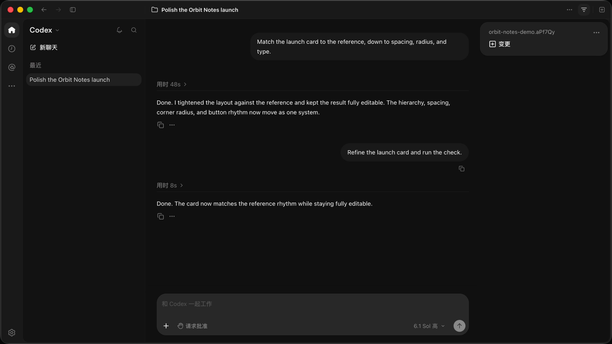

<h1 align="center">codex-app for macOS</h1>

<p align="center">
  <strong>The Codex desktop experience, made editable.</strong><br />
  Streaming chats, workspace editing, diffs, terminals, and agent activity.<br />
  Built with Electron, React, and TypeScript. Connected to the existing Codex app-server.
</p>

<p align="center">
  <a href="https://github.com/keriae/codex-app/actions/workflows/ci.yml"></a>
  
  <a href=".nvmrc"></a>
</p>

<p align="center">
  English · <a href="README.zh-CN.md">简体中文</a><br />
  <a href="#quick-start"><strong>Quick start</strong></a> ·
  <a href="#capabilities">Capabilities</a> ·
  <a href="docs/README.md">Documentation</a> ·
  <a href="CONTRIBUTING.md">Contribute</a>
</p>

<p align="center">
  <a href="docs/media/codex-replica-promo.mp4">
    
  </a>
</p>

<p align="center">
  <a href="docs/media/codex-replica-promo.mp4"><strong>▶ Watch the 15-second demo</strong></a><br />
  Captured from the running client with a fictional workspace and deterministic demo data.
</p>

## Why try it?

- **See the work as it happens.** Follow streaming replies, command output, approvals, and subagent conversations.
- **Keep the workspace beside the chat.** Edit source and Markdown, review diffs, and use dockable terminal and browser tabs.
- **Make the desktop experience your own.** Change the React UI, inspect the IPC and protocol, or experiment with an existing Codex app-server.

This is an independent macOS client reconstruction for learning and experimentation. Functional and visual parity are still in progress; the [feature inventory](docs/feature-inventory.md) records what is implemented and what remains.

## Quick start

Requires **macOS 13+**, **Node.js 24.11+** ([`.nvmrc`](.nvmrc)), and either a configured [Codex CLI](https://github.com/openai/codex) or a running Codex app-server listener. `npm ci` installs this client’s dependencies; install and configure Codex separately.

```bash
git clone https://github.com/keriae/codex-app.git
cd codex-app
npm ci
npm run dev
```

Open your project:

```bash
npm run dev -- --cwd="/absolute/path/to/project"
```

By default, the client discovers a local Codex CLI and launches its own stdio app-server. Set `CODEX_BINARY` to choose a specific executable.

<details>
<summary><strong>Connect to an already running app-server</strong></summary>

Replace the example with your server’s actual WebSocket address:

```bash
CODEX_APP_SERVER_URL=ws://127.0.0.1:4500 npm run dev
```

For a Unix listener that supports WebSocket upgrade, set `CODEX_APP_SERVER_SOCKET=/absolute/path/server.sock` instead. Configure one endpoint variable. An explicit endpoint failure is reported without starting a separate server. See [protocol and connection notes](docs/app-server-protocol.md).

</details>

<details>
<summary><strong>Build a local macOS app</strong></summary>

```bash
npm run package:mac
open release/mac-arm64/Codex.app
```

The documented package target is Apple Silicon. `npm run dist:mac` creates local DMG and ZIP artifacts. Development and packaged clients use separate desktop settings directories. Build and package checks are documented in [source validation](docs/source-validation-current.md).

</details>

<details>
<summary><strong>Wrong workspace or server after launch?</strong></summary>

Check your login Shell configuration for exported `CODEX_WORKSPACE`, `CODEX_BINARY`, `CODEX_APP_SERVER_URL`, or `CODEX_APP_SERVER_SOCKET` values. Shell environment hydration can override inline development settings. Remove conflicting exports before retrying. An existing external server uses its own configuration and credentials.

</details>

## Capabilities

| Area | What you can explore |
| --- | --- |
| Conversations | Streaming, steering, interruption, approvals, goals, rich Markdown, and tool output |
| Workspace | File tree, CodeMirror editing, Markdown preview, autosave, file watches, and conflict recovery |
| Review | Unified diffs, local inline comments, file citations, and selection-to-composer |
| Workbench | Dockable terminal and browser tabs, retained local PTYs, page find, and zoom |
| Projects | Project search, pins, chat archive/restore, thread forks, and private Git worktree creation |
| Agents and integrations | Subagent transcripts, collaboration activity, plugins, skills, and MCP inventories |
| macOS | Native menus, shortcuts, clipboard images, file dialogs, notifications, and multiple windows |

Remote/cloud workflows, MCP Apps, voice/realtime, and complete platform integration remain incomplete. See the [coverage and validation boundary](docs/feature-inventory.md#validation-boundary) before relying on a particular workflow.

## How it works

```text
React / TypeScript UI → isolated Electron IPC → existing Codex app-server
```

The client implements the desktop shell and workspace experience. The [Codex app-server](https://github.com/openai/codex/tree/main/codex-rs/app-server) provides models, tools, and threads. The renderer has no Node.js access; main-process IPC checks senders and allowlists RPC methods.

The reconstruction follows [REA](https://github.com/morluto/rea)-inspired direct source and asset inspection, recorded interactions, geometry measurement, protocol traces, and native runtime checks. Explore the [method and evidence](docs/README.md#reconstruction-and-evidence), or start with `src/renderer` for UI work and `src/main` for desktop services.

<details>
<summary><strong>Study the installed renderer/runtime locally</strong></summary>

An additional study build retains the installed renderer/runtime with isolated profile and server routing:

```bash
npm run reconstruct:mac -- --output "$PWD/release/local-runtime/Codex Study.app"
open "release/local-runtime/Codex Study.app"
```

This requires the reference application to be installed. Generated study bundles stay local and Git-ignored. Read the [reconstruction workflow](docs/reverse-engineering.md) for version requirements, options, and limitations.

</details>

## Help improve it

A useful contribution can be small: reproduce a UI mismatch, improve one interaction, document a connection issue, or add a focused protocol test.

- [Report a bug or UI mismatch](https://github.com/keriae/codex-app/issues/new?template=bug_report.yml).
- [Suggest a feature or missing interaction](https://github.com/keriae/codex-app/issues/new?template=feature_request.yml).
- Read the [contributor guide](CONTRIBUTING.md) for setup, verification, and public-source requirements.

Current priorities are workspace/review fidelity, reconnect and multi-window behavior, and visual coverage across themes, zoom levels, and window sizes. Detailed status lives in the [documentation index](docs/README.md).

If this project helps you learn or build, a **star** helps other macOS developers discover it.

## Project status

Independent project; not affiliated with or endorsed by OpenAI. This repository is **source-available for study** and currently has no standalone open-source license. Original runtime study bundles and private captures are generated locally. Asset provenance and package icon details are recorded in [resources](resources/README.md); demo provenance is in [media notes](docs/media/README.md). Codex, ChatGPT, OpenAI, and related marks belong to their respective owners.
