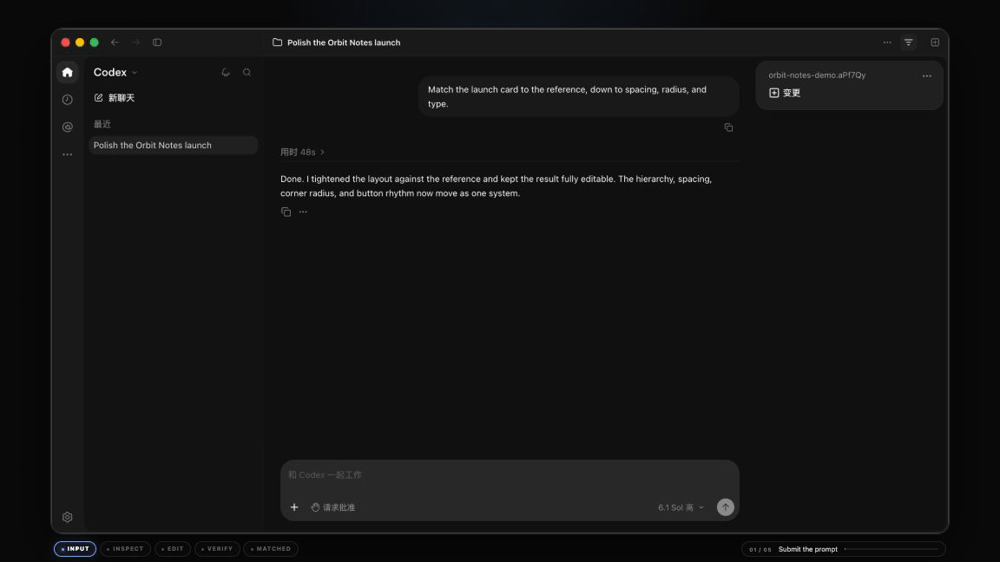
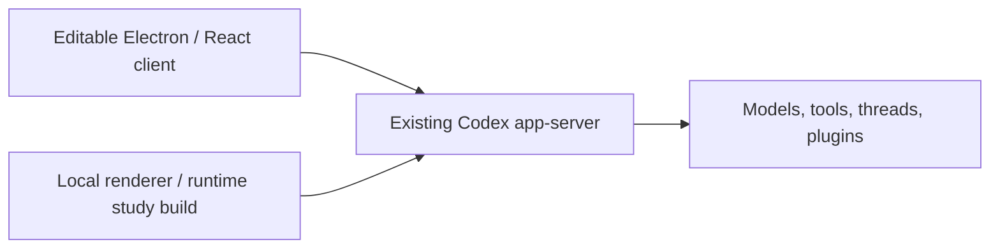

<h1 align="center"><code>codex-app</code> for macOS</h1>

<p align="center">
  <strong>An editable reconstruction of the macOS <code>codex-app</code> desktop client.</strong><br />
  Measured from shipped behavior and connected to an existing Codex app-server.
</p>

<p align="center">
  <a href="#quick-start"><strong>Run it locally</strong></a> ·
  <a href="#what-works-today"><strong>Capabilities</strong></a> ·
  <a href="#reconstruction-target"><strong>Reconstruction notes</strong></a> ·
  <a href="CONTRIBUTING.md"><strong>Contribute</strong></a>
</p>

## Demo

<p align="center">
  <a href="docs/media/codex-replica-promo.mp4">
    
  </a>
</p>

The demo follows a prompt through **INPUT → INSPECT → EDIT → VERIFY → MATCHED** inside the running `codex-app` reconstruction. [Watch the MP4](docs/media/codex-replica-promo.mp4).

## Quick start

Requirements: **macOS 13+**, **Node.js 24.11+** (see `.nvmrc`), and a configured Codex account or API provider.

```bash
npm ci
npm run dev
```

Open a specific workspace:

```bash
npm run dev -- --cwd=/absolute/path/to/project
```

The client can discover the installed application's companion CLI, a `codex` on `PATH`, npm's native Codex package, or Homebrew. Set `CODEX_BINARY` to choose an explicit executable. `CODEX_WORKSPACE` is also supported; `--cwd` takes priority.

Development and packaged builds use separate app-data directories.

## What works today

| Experience | Included capability |
| --- | --- |
| **Conversations** | Streaming turns, steering, interrupt, approvals, structured input, MCP output, goals, and rich Markdown |
| **Workspace** | CodeMirror tabs, file tree, source and Markdown editing, autosave, conflict recovery, file watches, and native file actions |
| **Review** | Unified diffs, local inline comments, selection-to-composer, change summaries, and file citations |
| **Terminal and browser** | Persistent local PTY sessions, remote shells, dockable tabs, and browser workbench state |
| **Projects and worktrees** | Project search, pins, archive and restore, thread forks, Git branches, private worktrees, and working-tree replay |
| **Agents and integrations** | Subagent transcripts, collaboration activity, plugins, skills, MCP inventories, and Claude Code/Cursor/Cowork import |
| **Desktop shell** | Native menus, multi-window routing, notifications, clipboard images, zoom, file dialogs, and macOS packaging |

See the [feature inventory](docs/feature-inventory.md) for the complete status and remaining parity work.

## Reconstruction target

This project reconstructs the macOS `codex-app` desktop client—not the Codex model or the app-server. It reuses an existing Codex app-server and provides an editable Electron, React, and TypeScript implementation of the desktop experience.

Visual fidelity is treated as a functional requirement. Titlebar geometry, navigation, sidebar density, composer placement, typography, panels, transitions, and interactive states are rebuilt from measured behavior rather than a single screenshot. The supporting evidence is documented in the [visual baseline](docs/visual-baseline.md), [workspace editor notes](docs/workspace-editor-parity.md), and [validation record](docs/reconstruction-validation-current.md).

## Two ways to explore

| | Editable client | Local runtime reconstruction |
| --- | --- | --- |
| Best for | Building features, changing UI, protocol experiments | Studying the installed renderer/runtime locally |
| Stack | Electron + React + TypeScript + Vite | Retained installed renderer/runtime with isolated routing |
| App-server | Existing Codex app-server | Existing Codex app-server |
| Output | `release/mac-arm64/Codex.app` | `release/local-runtime/Codex Study Final.app` |
| Distribution | Source in this repository | Generated locally and Git-ignored |



The server is reused, not reimplemented. The editable client is for building; the local renderer/runtime reconstruction is for studying shipped behavior.

## How the `codex-app` reconstruction was built

The reconstruction combines interaction study, captured geometry, source inspection, protocol traces, and native runtime checks. Claims are scoped deliberately: complete pixel and functional parity are still in progress, and the exact boundary is recorded in the [feature inventory](docs/feature-inventory.md) and [obligation ledger](reverse/obligations.json).

```text
src/main         Electron lifecycle, native services, IPC, transport
src/preload      Context-isolated, allowlisted renderer bridge
src/renderer     React UI, session reducer, streaming, workspace views
src/shared       Shared IPC contracts
scripts/reverse  Reconstruction, capture, and verification tooling
promo            Demo media source and privacy-safe app footage
```

The renderer has no Node.js access. Main-process IPC validates the sender and allowlists RPC methods. Packaged source builds use the restricted `app://-/index.html` origin.

<details>
<summary><strong>Build, package, and verify</strong></summary>

```bash
npm run typecheck
npm test
npm run build
npm run package:mac
```

Create local DMG and ZIP artifacts with `npm run dist:mac`. The local arm64 source bundle is written to `release/mac-arm64/Codex.app`.

To verify the exact package, see [source/package validation](docs/source-validation-current.md), then run the packaged runtime and recorded-layout checks:

```bash
release/mac-arm64/Codex.app/Contents/MacOS/Codex --remote-debugging-port=9225
npm run runtime:check -- 9225
npm run visual:check -- 9225
```

</details>

<details>
<summary><strong>Reconstruct the installed client locally</strong></summary>

```bash
npm run reconstruct:mac
open "release/local-runtime/Codex Study Final.app"
```

The builder preserves the installed renderer, fonts, preload, Owl runtime, native components, and desktop services while applying isolated profile/server routing, rebuilt ASAR integrity metadata, ad-hoc signing, and a disabled updater. It does not copy credentials or a browser profile.

Choose another output path for a new build:

```bash
npm run reconstruct:mac -- --output "$PWD/release/local-runtime/Codex Study 2.app"
```

See the [reconstruction workflow](docs/reverse-engineering.md) for options and platform limits.

</details>

<details>
<summary><strong>Connect an existing app-server</strong></summary>

```bash
CODEX_APP_SERVER_URL=ws://127.0.0.1:PORT npm run dev
# or
CODEX_APP_SERVER_SOCKET=/absolute/path/server.sock npm run dev
```

Socket sessions reconnect with the observed bounded backoff. Explicit endpoints never fall back to a new private process, and unacknowledged mutations are not replayed. See [transport recovery](docs/transport-recovery.md) and the [protocol notes](docs/app-server-protocol.md).

</details>

## Demo media

The committed demo uses a fictional workspace and isolated state; it does not include private projects, conversations, or credentials. Build and capture instructions are maintained in [promo/README.md](promo/README.md).

## Status and boundaries

- This is an independent reconstruction of the macOS `codex-app` client. It is not affiliated with, endorsed by, or distributed by OpenAI.
- It reuses an existing Codex app-server; it does not reimplement the server or distribute the official application.
- Complete functional and pixel parity remain in progress. Hosted authorization, platform attestation, DeviceCheck, APNs, shared Keychain entitlements, voice/realtime, and some remote/cloud surfaces remain outside the editable implementation.
- Original application code, private captures, credentials, browser profiles, generated app bundles, and local reconstruction outputs are not committed.
- The repository is currently source-available for study and does not yet include a standalone open-source license.

## Roadmap

- Broader remote/cloud host and MCP Apps coverage.
- Deeper multi-window, notification, accessibility, and reconnect parity.
- Richer workspace review, diff, and browser behavior.
- Wider visual regression coverage across representative themes and window sizes.
- An explicit project license after maintainer review.

## 中文简介

这是一个可以真实运行、编辑和二次开发的 macOS `codex-app` 客户端复刻。项目以界面测量、交互研究、协议记录和运行时验证为依据，还原桌面 Shell、对话、文件、Diff、终端、工作树和 Agent 等核心体验；Codex 模型与 app-server 不属于复刻范围。

```bash
npm ci
npm run dev
```

完整功能覆盖与未完成项请查看 [feature inventory](docs/feature-inventory.md)。

## Credits

- Reconstruction methodology inspired by [REA](https://github.com/morluto/rea).
- Codex, ChatGPT, OpenAI, and related marks belong to their respective owners.
