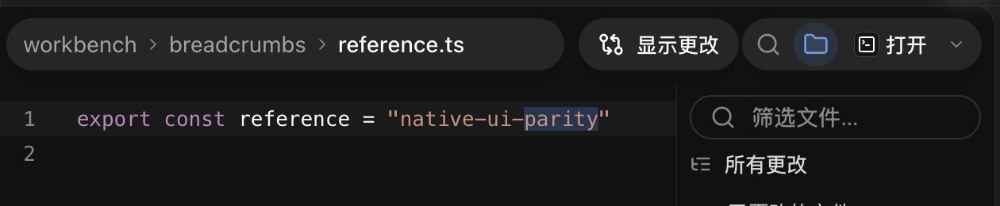
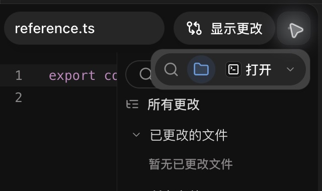
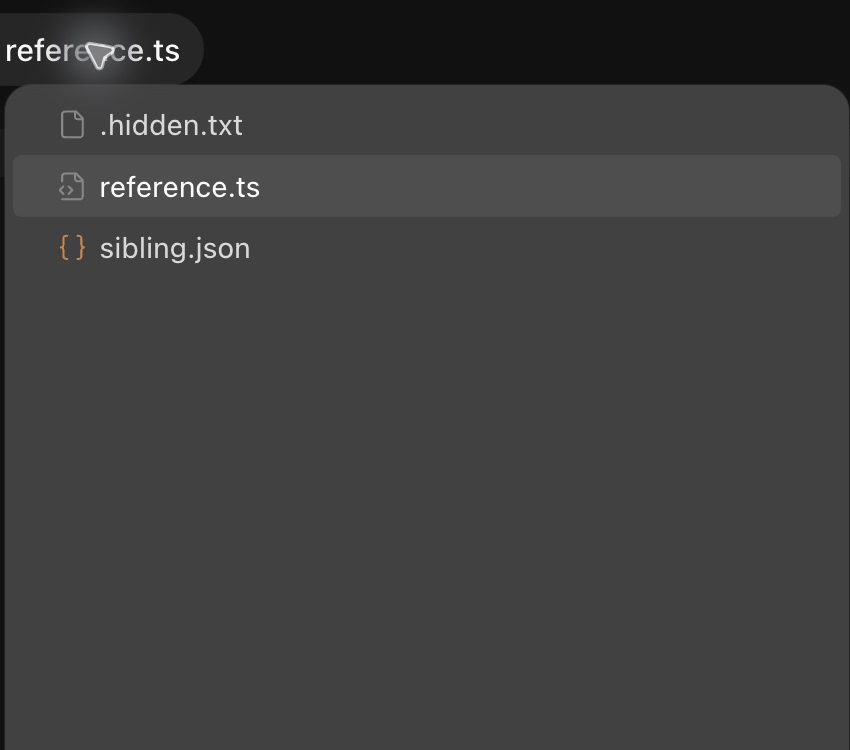

# UI 细节对比与优化 — 2026-10-30

本轮继续直接读取原安装包的 JS/CSS，核对用户录屏中的文件工作台，并操作可编辑复刻进行原生验收。重点补齐路径目录菜单、625px 以下的文件控件、工作台与对话的布局，以及真实剪贴板复制。完整复刻仍在进行，以下结果只覆盖明确列出的状态。

## 对照基准与方法

沿用用户指定的 [REA JavaScript application workflow](https://github.com/morluto/rea/blob/main/docs/javascript-application-workflows.md)：从已提取的 ASAR 模块追踪导出与组件关系，读取实际状态分支、CSS token 和布局公式，再核对离线录屏帧。没有使用 clean-room 方法，也没有执行提取出来的原 renderer。本轮复用了上一轮的 REA 选定模块分析，没有新增完整应用执行图。

| 基准 | 条件 | 本轮用途 |
| --- | --- | --- |
| 原安装包提取物 | 26.1023.50603 / 22391 | `Yt/Xt/Zt/Qt/$t`、路径元数据、tab close 分支、原生 clipboard service、controlSurface |
| 用户录屏 | 26.1016.61520 / 21421；3878 × 2282；DPR 2 下 1939 × 1141 CSS px | 8、134、152 秒工作台；对话活动帧沿用上一轮分析 |
| 本轮复刻原生窗口 | 4112 × 2402；DPR 2 下 2056 × 1201 CSS px | 320 / 620 / 630px 工作台、完整视图、100% / 110% 缩放 |

录屏保存的主侧栏为 468px，复刻使用 288px 默认值；窗口尺寸也不同，因此没有用整幅图的位置偏差计算“像素一致率”。本轮原应用 GUI 未被操作。原生输入与截图来自复刻；CDP 只调用复刻的 `window.codex` 后端 API，未用于点击、输入或截图。

## 逐项差异与修复

| 细节 | 原有差异 | 修复与参考 | 验收 |
| --- | --- | --- | --- |
| 文件名路径菜单 | 路径仅展示文字，没有真实目录导航 | filename 打开同目录文件列表，选中当前文件；`Qt/$t` | 原生显示 reference.ts、sibling.json 和 .hidden.txt |
| 祖先目录菜单 | 无法查看祖先目录的同级项目 | 读取被点击祖先的父目录，选中并展开该祖先；`pEa/Qt/$t` | 原生展开、左右键折叠/展开、Escape 回 trigger |
| workspace root 菜单 | 根目录与普通祖先未区分 | root 列出自身内容，不预选文件；`fEa/pEa` | 模型测试；root 点击的完整原生状态矩阵仍待补齐 |
| 路径窄宽度折叠 | 直接截断完整路径，文件名可能被挤掉 | 从最左祖先依次隐藏，最后保留 filename；`Yt/Xt` | 320px 时只保留完整 reference.ts |
| 路径自然宽度 | 动态折叠可能影响下一次测量 | 离屏测量各段，统一字体/padding，按 CSS zoom 换算 | 320 / 620 / 630px 与 110% 缩放原生复核 |
| 目录弹层尺寸 | 没有对应弹层 | 384 × 320 CSS px、4px 内边距、12px 圆角、opaque 表面；`DD.large/Qt` | 100% / 110% 原生截图；小窗口全方向定位仍待补齐 |
| 目录树键盘 | 缺少目录树导航 | 上下、Home/End、左右、Enter/Space；选中项初始居中 reveal | 原生 Down + Return 打开同级文件；Left/Right、Escape 通过 |
| 隐藏文件与异步状态 | 缺少 hidden entries、加载失败恢复 | 调用真实目录 API，保留 loading/error/empty/retry；原 `$t` 的 includeHidden | hidden entries 原生通过；失败/空目录主要由代码覆盖 |
| preview 文件切换 | 目录选择未接入文档状态 | 使用既有 documents store，以 preview 打开 | 原生 sibling.json 替换 reference.ts 预览标签 |
| 工具栏裁切 | editor 内负 right 扩展遇到 overflow:hidden，查找/文件树/打开按钮被裁切 | active toolbar portal 到 viewer 与 navigator 的公共容器 | 原生确认右侧按钮完整显示 |
| editor 顶部留白 | 只有 CodeMirror 留 margin，查找条仍可能顶到工具栏 | 48px 留白放到 editor stack | 原生查找条位于工具栏下方 |
| 窄工作台文件控件 | 按钮始终内联，挤占路径 | `<625px` 使用“文件控件”弹层，`>=625px` 内联；原 `Zt` | 620px 为弹层，630px 内联；320px 全部控件可用 |
| 弹层内按钮尺寸 | reparent 后失去工具栏祖先样式，查找图标变大 | 弹层复用 `workspace-pane-header-actions`，查找/文件树图标恢复 16px | 最终原生截图通过 |
| 嵌套菜单 Escape | 关闭“打开方式”时连父弹层一起关闭 | 子菜单捕获 Escape，只关闭自身并恢复其 trigger | 原生关闭后“文件控件”仍在，焦点回“选择打开方式” |
| 嵌套菜单残留 | 父弹层关闭后子菜单 state 可能继续拦截按键 | presentation 改变时清理子菜单 | 原生点击外部再重开，只有父弹层，首个查找按钮获焦 |
| 缩放弹层 | body portal 不继承 app-shell zoom，尺寸/定位可能错位 | 使用现有 windowZoom 的逻辑 rect/viewport，并对 portal 应用 zoom | 原生 ⌘+ 到 110%；后端 API 确认 1.1；⌘0 恢复 1 |
| 文件控件胶囊 | 透明背景和 1px 描边，与录屏实色胶囊不同 | 恢复 controlSurface 的表面、24px blur、明暗主题 shadow 分支 | 深色原生局部截图通过；浅色最终原生矩阵待补齐 |
| 非活动标签关闭按钮 | 一直显示关闭按钮 | active 显示；inactive 在 hover/focus-within 显示；原 tab `Ce` 分支 | 完整视图选聊天后，文件标签关闭按钮隐藏；hover/focus 的完整矩阵待补齐 |
| 宽屏对话被遮挡 | min-width:1537px 的摘要轨道居中规则也作用于 expanded workspace | 宽屏摘要规则限定到未展开工作台的状态 | 原生宽屏对话与 composer 留在左侧，工作台在右侧 |
| 命令/输出复制 | navigator.clipboard 被 Chromium 权限策略拒绝，无法真正复制 | 按原 `qyn` 使用原生 clipboard service；trusted IPC 验证发送者与字符串 | 命令/输出均显示“已复制”；实际粘贴确认输出首尾 |
| 其他文字复制 | 同一权限拒绝也影响代码/路径/Markdown/diff 等按钮 | 统一文字复制 helper，优先原生；浏览器独立运行时 fallback | 单元测试覆盖原生失败与 fallback；每个按钮未逐项原生复测 |

路径祖先菜单的准确行为是“展开被点击的祖先”，并非展开整条路径直到当前文件。本轮实现和测试按真实 `pEa` 分支恢复。

## 最终原生局部截图

这些截图只包含本轮临时工作目录的测试文件和工作台控件。全窗口截图、真实聊天列表和提取物保留在 Git-ignored `reverse/raw/`。截图里的光晕/箭头是原生捕获时的鼠标提示，不属于应用控件。

630px 工作台的路径和内联文件控件：



320px 工作台的文件控件弹层：



110% 缩放的当前文件目录菜单：



## 对话过程与真实后端验收

本轮通过复刻的原生 composer 提交一条临时只读请求，连接已有 Codex server。真实 turn 执行两条命令：一条输出 40 行 `native-output-01` 至 `native-output-40`，另一条读取 reference.ts；两条均 exit 0，turn completed，最终回复的两个文件链接可打开工作台。

验收覆盖上一轮恢复的单命令展开、144px 输出底端显示、退出成功状态、命令/输出复制和已读文件独立导航。复制输出后原生粘贴到临时 composer，确认首尾真实文本，随后清空，没有再次发送。对话活动图标的静态 SVG 对照、长命令展示规则及动画实现见 [上一轮明细](ui-detail-parity-2026-10-29.md)。本轮没有把截图当作 300ms 动画、长命令展开和完整活动分组的通过证明。

两条本轮创建的临时聊天在验收后清理，清理结果保留在本地 evidence。其他用户聊天不在本轮清理范围。

## 直接源码依据

| 原提取物中的函数/组件 | 对应实现 |
| --- | --- |
| `review-file-source-breadcrumb.Yt/Xt/Zt/Qt/$t` | WorkspaceBreadcrumbs、workspaceBreadcrumbModel、WorkspaceToolbarControls、WorkspaceFileToolbar |
| `app-initial.fEa/pEa/mEa`（Xct/Zct/Jct 导出） | root/ancestor/filename 目录根与 activePath |
| `app-primary` tab 的 `ye/Se/Ce` 分支，`data-app-shell-tab-close-button` | WorkspacePane.css 中 right-workbench-title-close |
| `app-shared.zLn/BLn`、controlSurface CSS、DD.large | 工具栏胶囊和弹层样式 |
| `app-shared.qyn` plain-text appServices.clipboard.writeText | clipboard helper、preload app:copy-text、main clipboard handler |

提取文件与来源哈希见 [脱敏证据](../reverse/ui-detail-evidence-2026-10-30.json)。源码文件继续保持可编辑，没有把原 minified bundle 当作 UI 实现。

## 验证与剩余范围

最终 **187 个文件 / 1,422 项测试**通过，Node/Web 类型检查、macOS arm64 打包通过；deep strict codesign、配置 fuses 回读和 **70/70** 当前构建文件与包内 ASAR 字节比较通过。交付包是 `release/mac-arm64/Codex.app`。本轮原生交互在当前 dev renderer 上进行；生产包本身的原生 UI 全状态验收没有重跑，不能由 ASAR 校验代替。

可重复的源码/包验证：

```sh
npm run typecheck
npm test -- --reporter=json --outputFile=reverse/raw/ui-detail-2026-10-30/tests.json
npm run package:mac
node scripts/reverse/verify-source-package.mjs release/mac-arm64/Codex.app reverse/raw/ui-detail-2026-10-30
```

尚未完成的重点：路径文字选区复制的原生验收；祖先菜单 root/empty/error 全状态；窄窗口弹层上下定位；浅色与不同 zoom 的完整矩阵；鼠标拖动调整宽度（本轮通过的是键盘 Home/Left/Right）；非活动标签 hover/focus/close 的完整矩阵；不同项目聊天/terminal/browser 来回切换；长命令、多个分组动作和动态展开动画。主文件树仍有旧 focus ring、spacing 与 decoration 差异，完整 Pierre 装饰、富 Markdown、语音/云端等范围继续见 [feature inventory](feature-inventory.md)。没有将完整功能或像素等价标记为完成。
